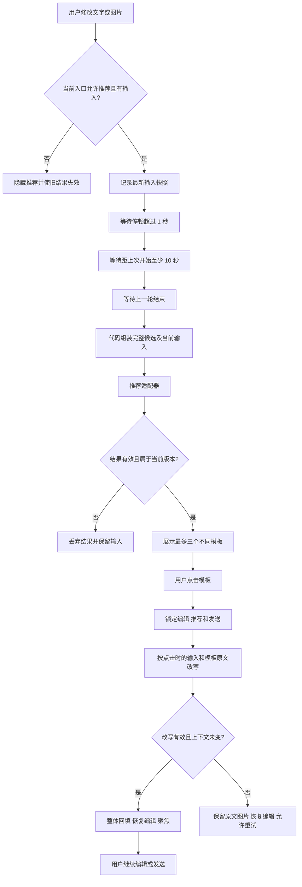

# 模板推荐与提示词改写

把用户输入、模板推荐和点击改写串成一个可复用流程。输入文字或图片后，自动匹配最多三个模板；点击其中一个模板，再以模板原文为基础改写当前文字，供用户继续编辑或发送。

这是一个独立的核心逻辑参考实现，包含状态控制器、任务组装、返回校验、长度保护、用量与费用处理以及回归测试。推荐与改写通过两个可替换的函数接入，没有指定模型、供应商或协议，也不内置模板数据、账号配置或外部请求。

## 快速运行

需要 Node.js 20 或以上，无第三方依赖。

```sh
pnpm test
pnpm demo
```

也可以直接执行 `node --test` 和 `node examples/demo.mjs`。演示只使用临时构造的合成输入和本地假适配器，用于验证接线与状态变化，不调用网络服务，不证明匹配或改写质量。

## 流程



## 保留的产品规则

### 推荐触发

- 快速模式在灵感与设计阶段均可触发。Agent 模式只在灵感阶段第一次发送前触发。
- 文字和图片都为空时隐藏推荐。推荐不会自动提交生成任务。
- 修改文字或增删、替换图片后，停顿超过一秒才可刷新。
- 同一个控制器实例的所有入口共用十秒间隔，按上一轮推荐开始时间计算。
- 同时最多一轮推荐请求。执行中继续输入，只保存最新版本；旧轮结束后，仍须同时满足停顿与间隔条件。
- 输入、模式、阶段、数据范围变化都会使旧结果失效，旧响应不能覆盖新输入的推荐。
- 失败不打断输入，不自动重试。阶段与失败信息供宿主界面显示或诊断。

十秒是单个实例内的调度规则。如果多个页面、标签页或设备需要共享配额，宿主服务应再做统一限流；这个前端状态控制器不承担服务端配额管理。

### 匹配输入与结果

候选由宿主提供已经获得使用权限的模板。核心逻辑只使用候选的键、短名称和完整提示词，不读取模板示例图，也不获取账号数据。

任务由代码直接组装，包含当前文字、当前图片、完整候选提示词及最多五条按时间倒序的历史文字。当前要求优先，图片用于识别当前内容，历史仅辅助偏好判断；缺少历史时照常匹配。任务组装不需要额外一次模型总结。

适配器可以返回有序模板键，也可以返回完整候选的分数。返回值经过校验，再选出最多三个不同模板；候选不足三个时按实际数量返回。未知键、重复键、缺失项和无效分数会被拒绝，不补造概率，不拆分候选后比较不兼容的分数。短名称上限为五个 Unicode 字符，宿主可以提供事先提炼的名称。

### 点击改写

- 点击时冻结当前文字、图片和所选模板完整提示词，进入应用中的状态。
- 应用期间不接受输入编辑、再次应用或发送。
- 改写以模板原文为底稿，保留结构和信息密度，结合当前内容替换主体与冲突项；用户当前明确要求优先。
- 目标长度接近模板本身，不额外扩写模板与用户都未要求的内容。
- 长度保护只判断是否失败，不截断、不自动补发一次请求。默认硬上限为 `min(1000, max(60, ceil(模板字数 × 1.25) + 20, 用户字数))`，参数可以调整。上限不代表目标长度。
- 成功后只整体替换文字，保留图片、恢复编辑，并通过 `focusVersion` 通知界面聚焦。
- 回填本身不再触发推荐，等用户主动修改后重新开始调度。
- 失败保留原文和图片，恢复编辑，并允许用户主动重试。

改写与模板原有应用逻辑可以并存。这个流程只产生文字草稿，后续生成行为由宿主决定。

## 接入

核心 API 与适配器约定见 [接口说明](docs/INTEGRATION.md)，完整可执行接线见 [本地演示](examples/demo.mjs)。

```js
import { TemplateWorkflow } from './src/index.mjs';

// candidates、history 和两个函数均由宿主提供。
const workflow = new TemplateWorkflow({
  candidates,
  history,
  recommend: recommendationAdapter,
  rewrite: rewriteAdapter,
  onChange: render,
});

workflow.edit({ text: userText, images: imageReferences });
// 用户点击当前推荐后调用 workflow.apply(templateKey)。
// 销毁组件时调用 workflow.dispose()。
```

适配器负责把通用任务转换为实际服务的请求，并把结果转换回契约。凭据、网络超时、图片格式、图片压缩和服务限制由宿主适配层管理。核心库不存储凭据，不安装服务 SDK，不自动降级或重试。

服务端仍需在每次请求验证当前用户、团队、模板权限和输入范围。不能把界面传入的模板键当作权限证明。切换数据范围时须原子替换候选与历史，使旧调用失效；已经发出的网络调用即使结果丢弃，也可能发生费用。

## 界面状态

界面可根据控制器状态显示等待触发、匹配中、等待上一轮、推荐就绪和应用中。匹配中可使用转圈和骨架占位；推荐出现或更新时可做一次呼吸描边；应用中保留可见原文和图片，并禁用编辑、推荐与发送。

本仓库提供状态与更新信号，不包含特定产品界面、设计资源或动画实现。推荐失败可静默处理；改写失败应明确提供重试操作。

## 时间与成本

等待、推荐请求和改写请求应分别计时。请求耗时包含适配器及外部响应，不包含用户选择时间；不要把本地假适配器的执行时间当成线上性能。

可选的用量和费用通过通用元数据传回。未知保持未知，不能默认当作免费。缓存读取与推理 Token 如果是输入、输出的子集，不再重复相加。只有拿到明确价格与计费规则后，才可以做估算，并与接口已报告费用区分。本仓库没有内置单价、性能数字或账单数据。

## 文件

| 路径 | 内容 |
| --- | --- |
| `src/index.mjs` | 状态控制器、任务构造与结果校验 |
| `test/workflow.test.mjs` | 使用虚拟时钟与假适配器的回归测试 |
| `examples/demo.mjs` | 无网络的最小接入演示 |
| `docs/INTEGRATION.md` | 接口与宿主职责 |

推荐质量、图片理解与改写质量取决于实际适配器，需要用宿主自己的授权数据另外验收。核心测试验证调度与状态行为，不代表任何外部服务已经联通。
